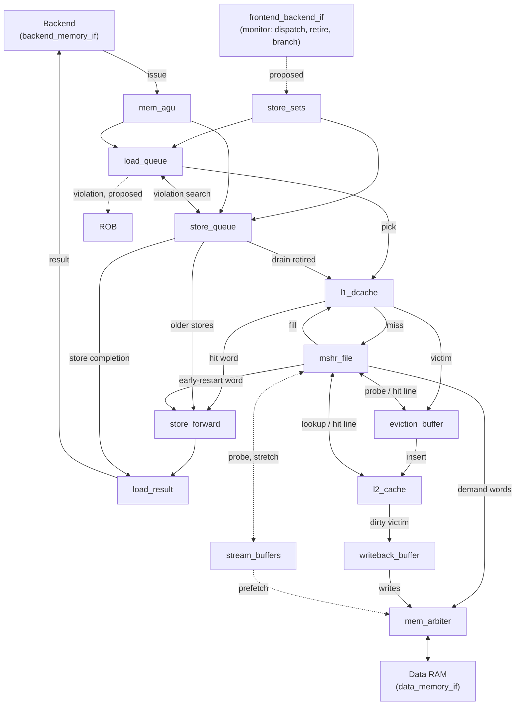

# Memory Subsystem

Everything between the backend and the data RAM: the load/store queue, store-set memory-dependence prediction, a lockup-free L1 with MSHRs, an exclusive lockup-free L2, and the buffers and arbiter in front of RAM.

**Status:** empty module shells, one file per block on the design page. Nothing is implemented yet. `memory_top.sv` keeps the instructor's port list so it still plugs into the system top.

The design follows the PDR design page, updated for the repo changes of Oct 30–31 (next section).

---

## What changed since the PDR page

| Change in the repo | Effect on our design |
|---|---|
| The accelerator now reads its image, weights and parameters from its own memories over `cnn_mem_if`, and its scratchpads are given inside `accelerator_top`. | The accelerator never touches data RAM. **Dropped:** the DMA port, the cache snoop, and the accelerator-coherence question. The arbiter only serves our own clients. |
| The instructor's RAM model (`dmem_model`) accepts up to 7 requests in flight and answers in order. | MSHRs can overlap misses without any interface change. `data_memory_if.sv` still says "one outstanding word transaction", so confirm with the instructors. |
| The instructor posted `memory_top.sv` and `tb_memory.sv` (commit `4341d2d`), then removed them from `main`. | `rtl/memory_top.sv` keeps their port list exactly, so it drops into the system top and the testbench. |
| `tb_memory` peeks RAM right after a store completes. | A write-back cache fails that check by design. Build a cache-less LSU in `memory_top` first (stage 0) to pass it. Ask how the instructors want the full design tested (backdoor read through the caches, or a flush before checks). |
| The "ROB-head operation at a time" comment was deleted from `backend_memory_if.sv`. | This matches the TA's answer: memory should handle several requests in flight. |

---

## Layout

```
memory/
├── README.md
└── rtl/
    ├── mem_pkg.sv            sizes from the design page
    ├── memory_top.sv         team top (instructor's port list); wiring, L1 port arbitration, perf counters
    ├── mem_agu.sv            Address gen
    ├── store_sets.sv         Store sets (SSIT + LFST)
    ├── load_queue.sv         Load queue
    ├── store_queue.sv        Store queue; retired head = store buffer
    ├── store_forward.sv      Forward & merge
    ├── load_result.sv        Load result: extract/extend + completion queue
    ├── l1_dcache.sv          L1 D-cache, lockup-free; tree-PLRU inside
    ├── mshr_file.sv          MSHRs
    ├── eviction_buffer.sv    Eviction buffer
    ├── l2_cache.sv           L2, exclusive, lockup-free; replacement policy inside
    ├── writeback_buffer.sv   Writeback buffer
    ├── mem_arbiter.sv        Memory arbiter
    └── stream_buffers.sv     Stream buffers (stretch)
```

One file per block on the design page. The small pieces live inside the block they serve: the rob_tag → entry table in the LSQ, the L1 port arbiter and perf counters in `memory_top`, tree-PLRU in `l1_dcache`, the L2 policy in `l2_cache`.

## Block diagram



## Parameters

All in `rtl/mem_pkg.sv`. The sizes are the PDR proposal, pending approval.

| | Value | Notes |
|---|---|---|
| LQ / SQ | 8 / 8 entries | ROB is 16; the spec's backend has one memory unit |
| L1 | 4 KB, 4-way, 16 B lines, 64 sets | tag `[31:10]` · index `[9:4]` · offset `[3:0]`; tree-PLRU |
| L2 | 32 KB, 8-way, 16 B lines, 256 sets | tag `[31:12]` · index `[11:4]` · offset `[3:0]`; exclusive |
| MSHRs | 4 | one per missing line; later misses to the line merge |
| Eviction buffer | 4 lines | fully associative |
| Writeback buffer | 2 lines | |
| Store sets | SSIT 128, LFST 16 | SSIT cleared every 16 384 cycles |
| RAM requests in flight | 4 | model allows 7 |
| Stream buffers | 2 × 4 lines | stretch |

Two build options to add as parameters, so the report can compare on identical hardware: the disambiguation mode (below) and the L2 policy (your group's assigned policy plus a FIFO or LRU baseline).

---

## How it works

### Load
1. At dispatch it takes an LQ entry in program order. If its PC belongs to a store set, it records that set's last dispatched store as the one to wait for.
2. The backend issues it when its operands are ready, and `mem_agu` fills in the address.
3. When the disambiguation mode lets it run, it searches older stores for forwarding and reads L1 in the same cycle. A load that just issued can go straight from address gen to L1 if the port is free.
4. A hit returns 2 cycles after issue. A miss goes to an MSHR, and L1 keeps serving other loads.

### Store
1. At dispatch it takes an SQ entry and becomes its set's last store in the LFST.
2. When issued, it records address, byte enables and lane-shifted data together and completes to the ROB right away.
3. Its address searches younger loads that already ran. If one read those bytes, the load is flagged and store sets are trained. The check is conservative: it can flag a load that forwarded the right value from a later store, which costs a flush but is always safe.
4. After the ROB retires it, the entry drains into L1 in program order. The retired entries at the SQ head are the store buffer.

### Miss
1. An MSHR takes the line. Later misses to the same line attach to it.
2. It probes the eviction buffer, L2 and the stream buffers. A hit sends the requested word to the load first, then moves the line into L1 and removes it from where it was.
3. Otherwise it requests the line's words from RAM, critical word first, tagged with its id, and returns that word as soon as it arrives.
4. The L1 victim, clean or dirty, goes to the eviction buffer and then L2. Dirty L2 victims go to the writeback buffer; clean ones are dropped.

L2 never allocates on a miss: RAM fills go straight into L1. So L2 needs no MSHRs of its own, and it's lockup-free just by never waiting on RAM.

### Recovery
- **Mispredict:** drop every LQ entry and unretired SQ entry with `under_branch` set. Invalidate LFST entries that point at dropped stores. On a correct resolve, clear the bit. The core allows one unresolved branch, so one bit per entry is enough.
- **Violation:** report the load on the proposed violation port. When it reaches the ROB head, the ROB flushes and refetches from its PC instead of retiring it.
- **Full flush:** clear the LQ, unretired SQ entries and the LFST. Retired stores stay; they're already architectural. MSHRs finish their fills but wake no loads.
- **Training:** each violation puts the load's and store's PCs in the same store set.

### Disambiguation modes

| Mode | A load runs when | Violations |
|---|---|---|
| `CONSERVATIVE` | every older store has an address | never; needs no flush path |
| `SPECULATE` | immediately | every one costs a flush |
| `STORE_SETS` | the store its set predicts has resolved (stores in a set are chained, as in the paper) | rare |

One LSQ, three policies, so the report compares them on identical hardware. `CONSERVATIVE` is the fallback if the frontend's flush path isn't ready.

---

## Rules that keep it correct

- **Exclusivity:** every line lives in exactly one place: L1, an MSHR, the eviction buffer, L2, the writeback buffer, or a stream buffer. Write this as one SVA assertion and run it in every configuration.
- **No line in zero places:** an eviction-buffer entry stays searchable until L2 says the line is visible (`insert_done`). Otherwise a probe can miss the line in both places and fetch stale data from RAM.
- **L2 has one serialized port:** lookups and inserts take turns, so a probe never lands in the middle of an insert.
- **Writebacks can't starve:** the arbiter puts demand misses first, except when the writeback buffer is full.
- **Every RAM request gets exactly one response, stores included.** Count the acks.
- **Age inside the LSQ comes from allocation order, not ROB tags.** It's cheaper, and the instructor's testbench gives every op `rob_tag` 0.

---

## Interfaces

**Used today, unchanged:** `backend_memory_if.memory`, `data_memory_if.client`.

**Proposed changes:**

| Change | Direction | Why | Coordinate with |
|---|---|---|---|
| Issue any memory op whose operands are ready, not only the ROB head | backend → memory | several ops in flight | Backend |
| Allocate LQ/SQ entries from the accepted dispatch bundle | `frontend_backend_if` monitor modport | program-order entries, PC for store sets | none; no new wires |
| `retire_valid` / `retire_tag`, branch resolve | monitor modport | stores write L1 only after retire; squash | none |
| `lq_free`, `sq_free` | memory → backend | dispatch stalls when the LSQ is full | Backend |
| `violation_valid`, `violation_tag` | memory → ROB | flush at the load when it reaches the head | Frontend (the ROB is on its side) |
| `flush_all` | ROB → backend, memory | clear wrong-path state; frontend restores rename from its committed map | Frontend, backend |
| Ports on `memory_top` and `rv32_ooo_top` for the above | — | the system top is shared | All four teams |

Until these land, memory only has `backend_memory_if` and `data_memory_if`, so stages 0–2 allocate LSQ entries at issue and rely on the backend issuing memory ops in program order.

---

## Build order

Each stage is a working design that integrates on its own.

| Stage | What | Gate |
|---|---|---|
| 0 | Cache-less LSU in `memory_top`, using `mem_agu` and `load_result` | instructor `tb_memory` passes all stages under the hostile RAM (35 % stalls, latency 0–4) |
| 1 | LSQ in `CONSERVATIVE` mode allocating at issue, L1 and L2 with a single MSHR, eviction and writeback buffers, arbiter | golden-memory scoreboard under random traffic; exclusivity assertion |
| 2 | 4 MSHRs, lockup-free L1/L2, early restart, reuse-bit L2 insertion, perf counters | same scoreboard; hit-under-miss and miss-under-miss tests |
| 3 | Dispatch-time allocation, `SPECULATE` and `STORE_SETS` | needs the proposed interfaces and the frontend's flush; violation and squash stress tests |
| 4 | Stream buffers | prefetch used/wasted counts on streaming benchmarks |

## Verification plan

- **Golden flat-memory scoreboard** (cocotb or SV): every load value checked against a byte-array model, under constrained-random loads/stores of all sizes, in every parameter configuration.
- **Hostile RAM:** always run with `dmem_model` stalls and latency on. An LSU that passes at (0, 0) and fails at (35, 4) has a real bug.
- **SVA:** exclusivity, one response per request, no completion for a squashed op, LSQ pointer sanity.
- **Directed tests** for the spec's list (3.6): byte/half/word, signed/unsigned, forwarding, multiple stores to one address, partial overlaps, L1/L2 hits and misses, replacement, dirty eviction, backpressure.
- **Recovery stress:** random mispredicts and flushes while loads are waiting on MSHRs.

## Open questions

1. Who signs off on each proposed interface change, and by when?
2. Can the frontend flush at the ROB head and restore rename state from the committed map? The speculative modes depend on it.
3. How should the full design be tested when `tb_memory` peeks RAM directly? Backdoor reads through the caches, or a flush first?
4. `data_memory_if.sv` says one outstanding transaction, but `dmem_model` allows seven. Which is the contract?
5. There are no privilege modes. What should happen on a misaligned access or a RAM `error`? Our default: assert in simulation and assume tests never do it.
6. Is there a memory-mapped or uncached region, such as a test pass/fail address? Those accesses must bypass the caches and wait for the ROB head.
7. How is FENCE decoded? `uop_class_e` has no FENCE class.
8. Target board and BRAM budget, to confirm the cache sizes.
9. How should promotion be defined for an exclusive L2, where a hit removes the line?
